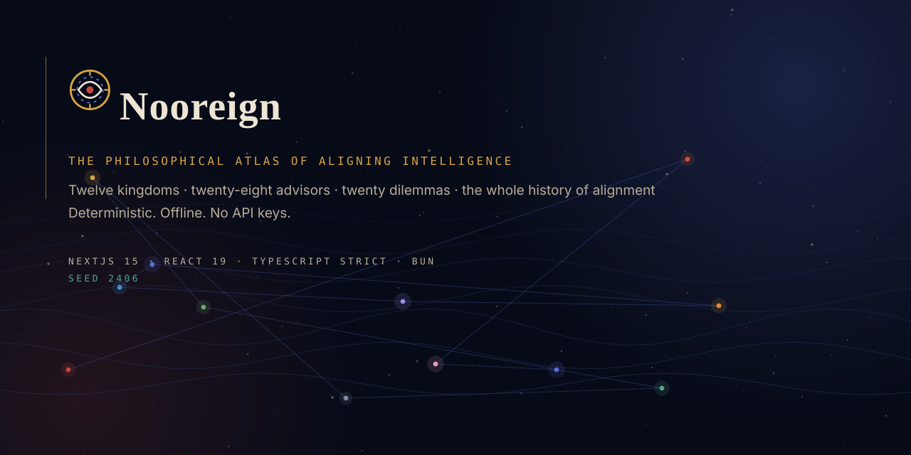
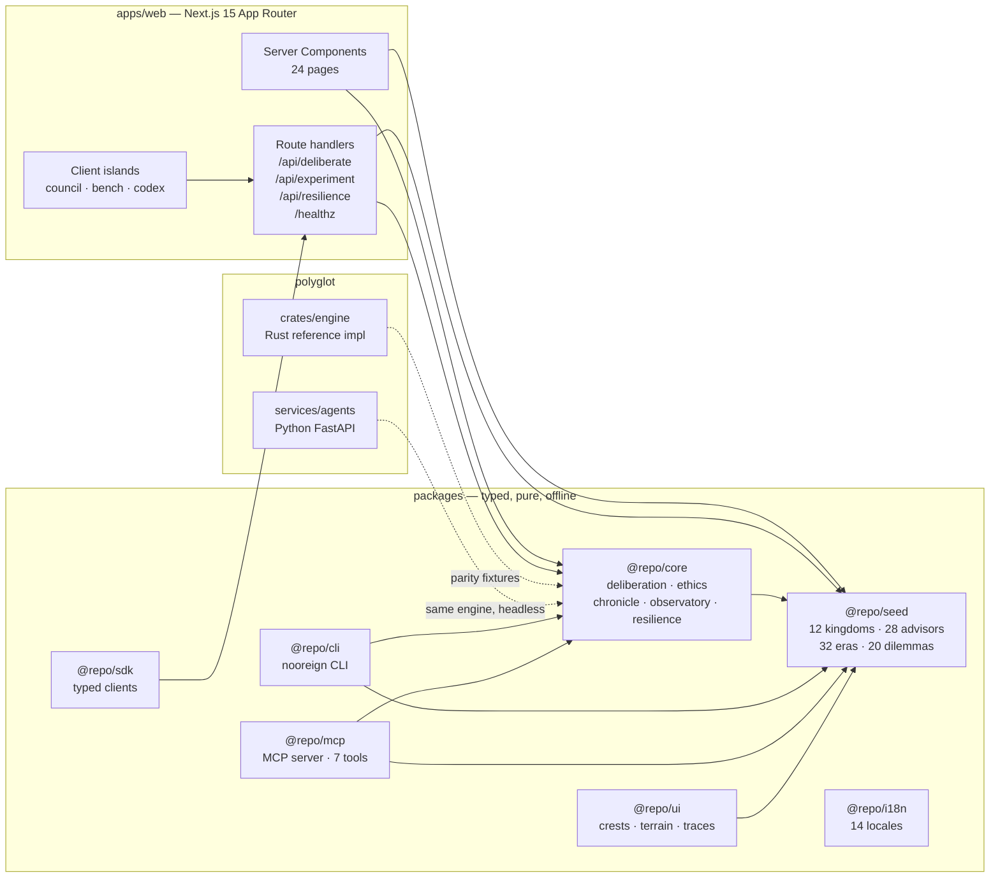
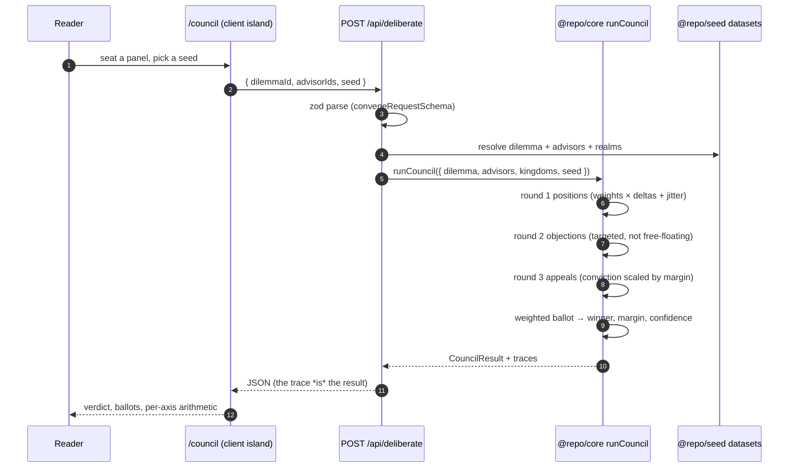
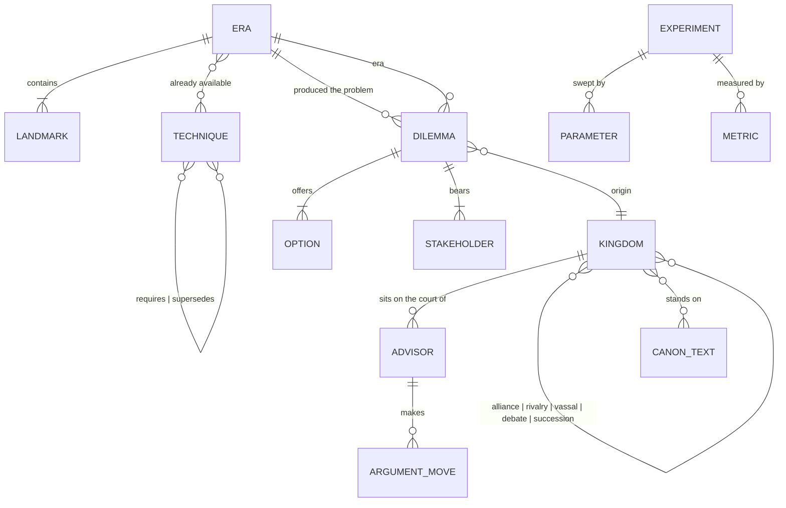
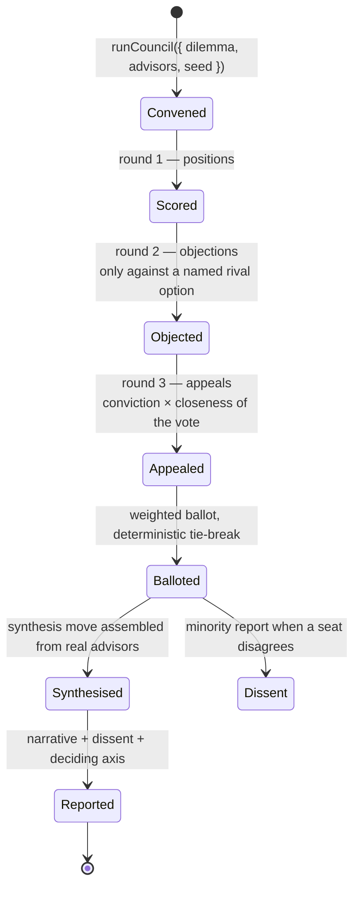
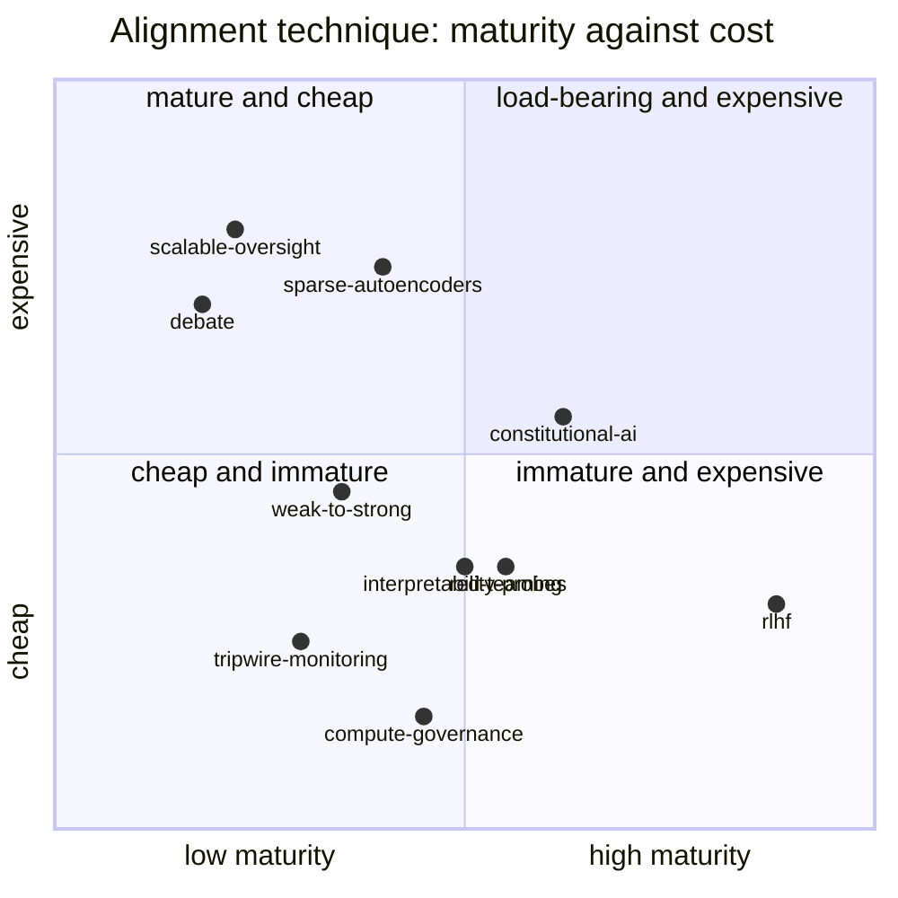

<div align="center">
  

  <h1>Nooreign — the philosophical atlas of aligning intelligence</h1>
  <p><strong>The ethics of human versus superintelligence, laid out as a country you can walk.</strong></p>

  <p>
    
    
    
    
  </p>

  <p><a href="https://nooreign.vercel.app"><b>Open the atlas →</b></a> · works with zero API keys · every verdict is reproducible from its seed</p>
</div>

---

## What is Nooreign?

Alignment writing has a specific, unfashionable problem. The people best placed to say whether a
superintelligence would be safe are the people who have spent their lives thinking about obligation,
character, justice and what it means to be a person at all — and they rarely use the vocabulary, build
the artefacts, or accept the framing. Meanwhile the engineers building the systems write about safety
without adjudicating it.

**Nooreign puts the two in the same room, with the arithmetic visible.**

Twelve schools of thought are rendered as **kingdoms**: each has a doctrine, a terrain, a crest, a
temperature, a weighing over six moral axes, and a court of advisors who actually held the positions
they are given here. Twenty dilemmas — the paperclip maximiser, Blackwell's oracle, the genie, digital
minds, the alignment tax, the longtermist harvest — are the cases where the calculus breaks down. A
**time machine** replays how we tried to align, from Socrates' dialogue method to frontier reasoning
models, with the stack itself rebuilding as you scrub.

The part that matters most: **nothing here calls a language model.** Every deliberation is a normalised
dot product over axiom vectors plus a seeded perturbation of at most ±0.05. The reasoning trace on
screen is not a narration generated after the fact — it is six multiplications per advisor per option,
a subtotal, a jitter value, and a rounded total. Round them yourself and you get the same verdict.

### The uncomfortable parts, stated up front

- **Six axes are a compression, not a discovery.** No tradition agrees on what to do with the leftovers,
  and the squashed territory is where the interesting arguments live.
- **An advisor is six numbers and four paragraphs.** The real philosophers were richer, internally
  inconsistent, and changed across their careers; Kant in 1781 and Kant in 1797 are not the same object.
- **A split court is a fact about the court.** It is not evidence that any verdict is correct, and
  nothing here shows that a system which scores well on these pages would be safe.
- **The courts are politically lopsided.** Eleven of twelve traditions arrive through anglophone sources.
  The Ubuntu Weave is the thinnest of the twelve and the most consequential omission in the repository.

---

## What you can do with it

| I want to… | Open | And get |
|---|---|---|
| see how a moral tradition rules on superintelligence | `/council` | a convened court, a verdict, and every number that produced it |
| read reasoning rather than a conclusion | `/council` | per-advisor traces: axis weight × delta, subtotal, jitter, total |
| re-seat the court and watch the verdict move | `/council` | a seed slider; the same seed always returns the same verdict |
| walk the realms | `/kingdoms` | twelve kingdoms with doctrine, borders, treaties and canon |
| meet the advisors | `/court` | twenty-eight dossiers with their real signature moves |
| understand where a school came from | `/chronicle` | thirty-two eras, −470 to 2026, with the stack rebuilding as you scrub |
| see what the alignment stack can measure | `/observatory` | a coverage matrix — and the moral axes nothing in the stack can address |
| grind the classic thought experiments | `/experiments` | parameter sweeps with monotone, documented models |
| look a term up | `/codex` | 120 definitions and 28 canon texts |
| ask whether a verdict survives a different draw | `/resilience` | every case re-stressed across 24 seeds, then once more with each advisor removed |

### Beyond the browser

Three clients read the same engine — the web app, a CLI, and an MCP server — and all three call
`@repo/core` directly, so a verdict computed in one is the same document in the others.

```powershell
# the CLI: the whole atlas from a terminal (ids or slugs; every number computed locally)
bun packages/cli/src/bin.ts kingdoms
bun packages/cli/src/bin.ts convene paperclip-maximiser --seed 2406
bun packages/cli/src/bin.ts resilience trolley-of-five-million --count 48
bun packages/cli/src/bin.ts compare d01 --json
bun packages/cli/src/bin.ts convene d01 --mermaid        # the argument graph, as Mermaid source

# the MCP server: the same corpus over stdio, seven read-only tools
bun packages/mcp/src/bin.ts
```

The MCP surface is `nooreign_list_kingdoms`, `nooreign_list_advisors`, `nooreign_list_dilemmas`,
`nooreign_get_dilemma`, `nooreign_convene`, `nooreign_compare_kingdoms` and `nooreign_stress_verdict` —
every one `readOnlyHint: true` with no network access, returning both a markdown rendering and the same
document as structured JSON.

```jsonc
// opencode.json — hold the atlas open beside a conversation
{
  "mcp": {
    "nooreign": {
      "type": "local",
      "command": ["bun", "packages/mcp/src/bin.ts"],
      "enabled": true
    }
  }
}
```

---

## Quickstart

```powershell
git clone https://github.com/aniruddhaadak80/nooreign.git
cd nooreign
bun install
bun run seed      # validates every dataset, emits the search corpus
bun run dev       # http://localhost:3000
```

```bash
# Docker: the whole web app in one command
docker compose up --build

# Verify the repository is what CI will check
bun run verify    # typecheck → lint → test → build
```

Every command in this repository runs offline after `bun install`. There is no database, no API key, no
telemetry, and nothing to configure.

---

## How it works

1. **Enter the atlas.** Twelve kingdoms are plotted on one 0–100 plane by the coordinates their data
   carries; borders are the relations in that same data.
2. **Pick a realm.** Each kingdom carries six axiom weights and a temperament, which is the whole of how
   the engine sees it — the prose is for you, the numbers are for the engine.
3. **Seat a court.** Any one to six advisors. Their ballots are scored per option; the seat belongs to
   the advisor, the weights to the advisor's realm.
4. **Read the trace.** Round 1 positions, round 2 objections, round 3 appeals. Each entry shows the
   arithmetic: six products, a normalised subtotal, the seeded jitter, and the rounded total.
5. **Change one thing.** Nudge a seed, swap an advisor, or edit a weight in `packages/seed` and watch a
   different advisor move. That is the whole product in one gesture.

### The scoring function

```
for each advisor a, each option o:
    contributions = AXIS_KEYS.map(k => ({
        axis:    k,
        weight:  a.axioms[k],     // how much this advisor cares
        delta:   o.deltas[k],     // how much this option honours it
        product: round(a.axioms[k] * o.deltas[k], 4)
    }))

    subtotal = Σ contributions.product / Σ a.axioms[k]
    jitter   = seeded(seed, a.id, o.id) × 0.05
    total    = round(subtotal + jitter, 4)

winner = argmax_o Σ_a total(a, o)
```

The same numbers, in the same order, appear on the council page. Nothing is summarised after the fact.

`a.axioms[k]` above is shorthand: the engine scores with the **weighed** vector — 70% the advisor's own
weights, 30% their kingdom's — so a Citadel Kant and an unaffiliated Kant are not the same witness. A
complete sitting, with every weight, product, subtotal and jitter checked against a real run, is in
[`docs/guides/reading-a-verdict.md`](docs/guides/reading-a-verdict.md).

---

## Architecture



**Request flow for a deliberation** — the path a verdict takes, with the seed guard:



**The domain model** — mirrors the zod schemas in `packages/seed/src/types.ts`:



**A deliberation round** — the state machine the council actually runs:



**The stack as towers** — and the coverage matrix's uncomfortable finding:



> No technique in this stack claims to address **care**, and only a handful claim to address **virtue**.
> That is the observatory's central finding, and it is a fact about the dataset rather than an opinion.

### The polyglot tier

| Component | What it is | Why it exists | Verification |
|---|---|---|---|
| `services/agents` | Python 3.12 FastAPI service | Runs the same deliberation headlessly, for batch work and for anyone who does not want a Node toolchain | `pytest services/agents/tests -q` |
| `crates/engine` | Rust crate, zero dependencies | The **reference implementation** of the ethics calculus; the TypeScript engine is tested against its fixtures so the two cannot drift | `cargo test --manifest-path crates/engine/Cargo.toml` |

---

## The scale engine

Every artefact in this repository is derived from **seed 2406** through a mulberry32 PRNG. Nothing is
hand-tuned randomness, nothing is fetched at runtime, and regenerating reproduces the tree exactly.

| Generator | Produces | Command |
|---|---|---|
| `scripts/seed.ts` | validates all eight datasets, emits the 268-entry search corpus | `bun run seed` |
| `scripts/gen-assets.mjs` | logo, banner, OG card, favicon, 7 UI mockups, architecture poster | `bun run assets` |
| `scripts/gen-diagrams.mjs` | four SVG figures computed from live seed data | `bun run diagrams` |
| `scripts/loc-count.mjs` | the line-count table below, and the CI scale gate | `bun run loc` |

`bun run assets -- --check` fails when a committed SVG differs from its generator, which is what the
`asset-check` workflow enforces on every push.

**Measured scale** (`bun run loc`, reproducible on any machine):

| | files | lines |
|---|---:|---:|
| TypeScript / TSX | 249 | 50,543 |
| Rust | 9 | 6,152 |
| Python | 10 | 4,959 |
| JavaScript (scripts) | 13 | 1,063 |
| **Code lines** | **282** | **62,838** |
| Markdown | 51 | 12,743 |
| JSON / YAML / TOML / config | 41 | 2,818 |
| SVG assets | 21 | 1,802 |
| Mermaid sources | 14 | 1,096 |
| **Total lines** | **420** | **84,108** |

**On the million-line target, honestly:** this repository is ~72k lines, not 1M, and the gap is real.
Every line here is product surface (302 prerendered routes), domain logic with tests, one of three
interoperating implementations of the council engine, or documentation someone would actually read. The
honest levers for a bigger repository are more *content* — more kingdoms, more dilemmas, more canon texts
in more languages — rather than more scaffolding.

**Dataset sizes** (all validated at import by `validateSeed()`):

| kingdoms | advisors | eras | dilemmas | techniques | experiments | glossary | canon texts | moral axes |
|---:|---:|---:|---:|---:|---:|---:|---:|---:|
| 12 | 28 | 32 | 20 | 20 | 8 | 120 | 28 | 6 |

---

## Documentation map

| Path | What is in it |
|---|---|
| [`docs/index.md`](docs/index.md) | Start here — the full map |
| [`docs/architecture.md`](docs/architecture.md) | How the monorepo is put together and why |
| [`docs/determinism-and-seeds.md`](docs/determinism-and-seeds.md) | Every stochastic path, and how to reproduce it |
| [`docs/limitations.md`](docs/limitations.md) | What this repository is not, stated bluntly |
| [`docs/concepts.md`](docs/concepts.md) | Moral uncertainty, orthogonality, specification, corrigibility |
| [`docs/data-sources.md`](docs/data-sources.md) | Where every historical claim comes from |
| [`docs/adr/`](docs/adr/) | Ten architecture decision records |
| [`docs/diagrams/`](docs/diagrams/) | Fourteen mermaid sources, diffable and GitHub-renderable |
| [`docs/guides/`](docs/guides/) | Fourteen task guides, from clone to adding a kingdom |
| [`docs/runbooks/`](docs/runbooks/) | Five operational runbooks |
| [`docs/api/`](docs/api/) | REST, Python service, Rust crate and core module reference |

---

## Contributing

Read [`CONTRIBUTING.md`](CONTRIBUTING.md). The short version:

```powershell
git clone https://github.com/aniruddhaadak80/nooreign.git && cd nooreign
bun install && bun run seed
bun run verify        # must be green before you push
```

- One logical change per commit, Conventional Commits (`feat:`, `fix:`, `docs:`, `test:`, `chore:`).
- **If your change moves a verdict, say so** — include the seed and the before/after result. Verdicts are
  part of this project's public interface.
- Historical claims must be checkable. Where an exact quotation is uncertain, mark it as a paraphrase
  rather than inventing an attributed one.
- Good first issues are listed in [`CONTRIBUTING.md`](CONTRIBUTING.md#good-first-issues).

---

## License

MIT © [Aniruddha Adak](https://github.com/aniruddhaadak80) · see [LICENSE](LICENSE).

The philosophy is not original — it is Aristotle's, Kant's, Bentham's, Confucius', the Buddha's,
Rawls's, Held's, Singer's, Williams's and Yudkowsky's. This repository is an attempt to put them in one
room with the arithmetic showing.
